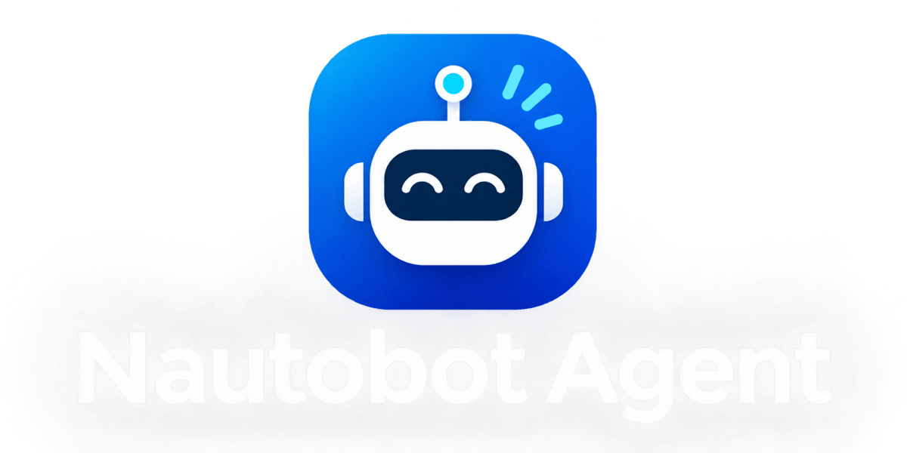

---
hide:
  - navigation
---

# Nautobot Agent

An [App](https://networktocode.com/nautobot-apps/) for [Nautobot](https://nautobot.com/).

## Overview

Nautobot Agent adds a general-purpose conversational agent to Nautobot. It can answer questions and provide explanations or code examples in chat, and connect conversations to Nautobot inventory and installed-App knowledge through permission-aware tools. Built-in tools cannot modify files; file operations require separately enabled MCP tools. The default scope policy admits Nautobot-related requests; administrators can change that policy without changing built-in data permissions.

## User guide

- [Overview](user/app_overview.md) · [Getting started](user/getting_started.md)
- [Conversations](user/conversations.md)
- [Charts and diagrams](user/charts_and_diagrams.md) · [FAQ](user/faq.md)
- [Privacy and data handling](user/privacy.md) · [External interactions](user/external_interactions.md)

## Administrator guide

- [Installation](admin/install.md) · [Configuration](admin/configuration.md)
- [Permissions and source access](admin/permissions.md) · [Integrations](admin/integrations.md)
- [Operations](admin/operations.md) · [Compatibility](admin/compatibility.md)
- [Upgrade](admin/upgrade.md) · [Removal](admin/uninstall.md)

## Developer guide

- [Building documentation](dev/documentation.md)
- [Code reference](dev/code_reference.md): generated configuration interfaces from Python source.
