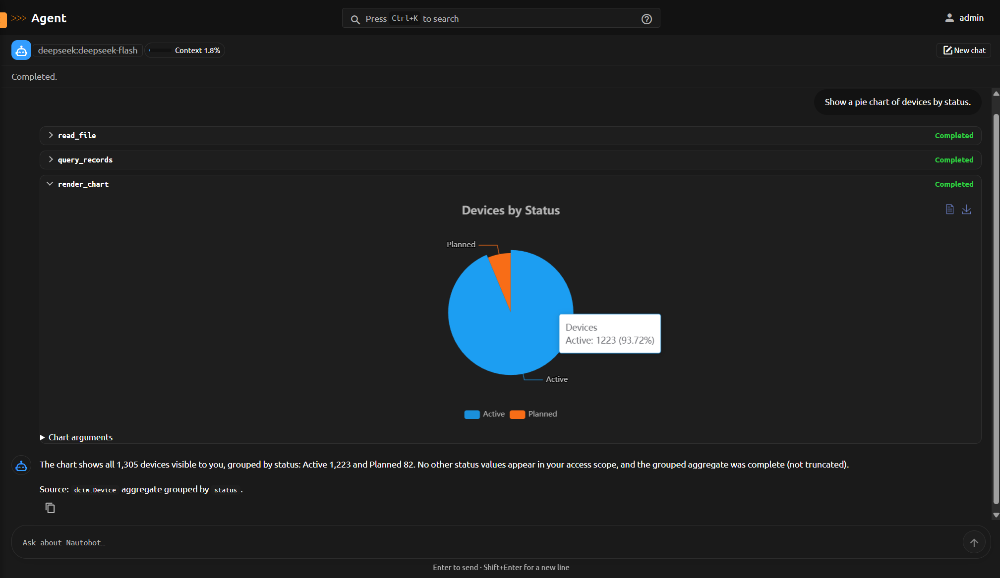
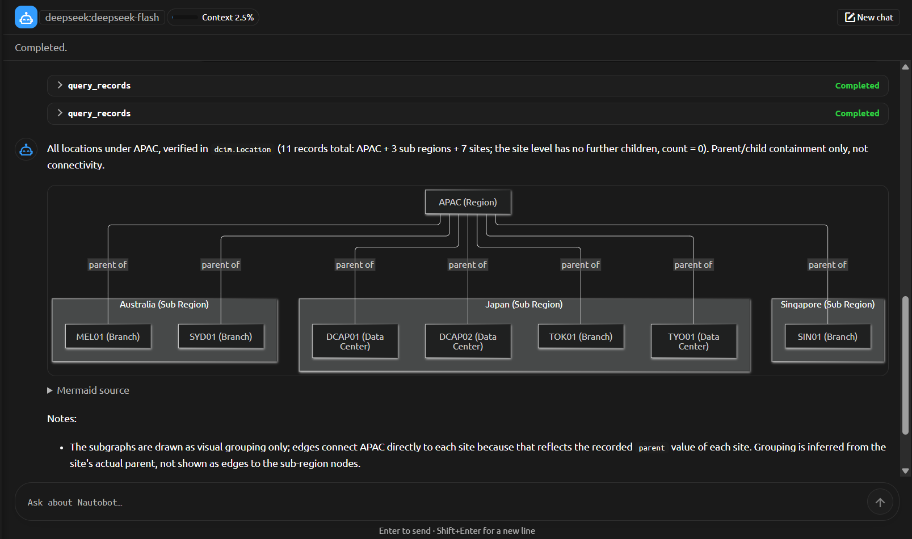

# Charts and diagrams

Ask explicitly for a chart or structural diagram. Visualizations do not change Nautobot records. Results may be incomplete because of permissions, query limits, or unavailable values; check underlying records before relying on them.

## Numeric charts

The Agent supports **bar**, **line**, and **pie** charts using numeric results it obtains; it should not estimate missing values. For example, request a pie chart of returned records grouped by a numeric status count.

Bar charts are vertical and grouped by default; ask for **horizontal** bars for long labels or **stacked** bars to compare contributions. Stacks are not percentages. Bar and line charts support up to 10 series and 100 categories; pie charts support one series and up to 50 slices. If the data exceeds these limits, narrow or aggregate your request. Missing bar and line values remain gaps, not zero.

Only numeric values can be charted. Query results may be partial; a chart does not establish that omitted records or relationships do not exist.

A numeric chart displayed in an Agent conversation. The captured counts illustrate the interface, not your current inventory.

## Mermaid diagrams

For an explicit request, the Agent can draw a structural diagram to describe relationships, network structure, a workflow, or an ordered exchange. Say whether you want a conceptual diagram or one based on observed records. A diagram does not prove live connectivity, reachability, health, or completeness.

Unsupported diagram syntax may appear as readable text instead of a rendered diagram. For network relationships, distinguish recorded connections from operational state. For numeric comparisons, request a chart.

A structural diagram rendered in an Agent conversation. The captured locations illustrate the interface, not your current inventory.

For data boundaries, see [Privacy and data handling](privacy.md).
