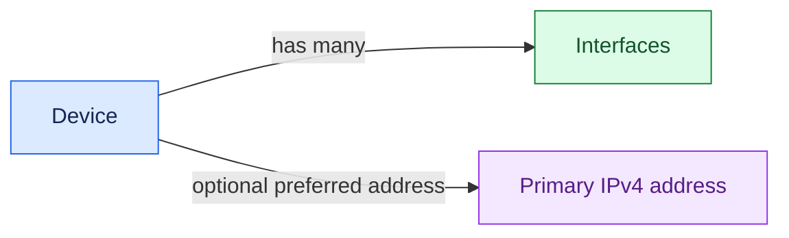
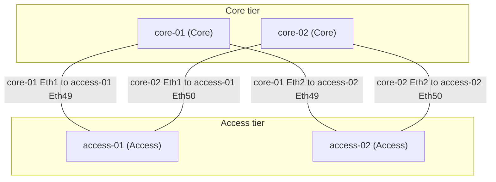
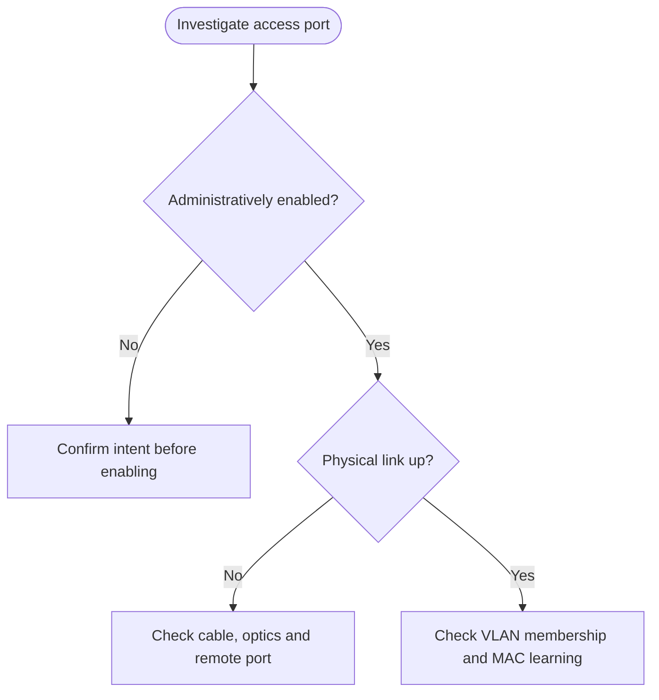
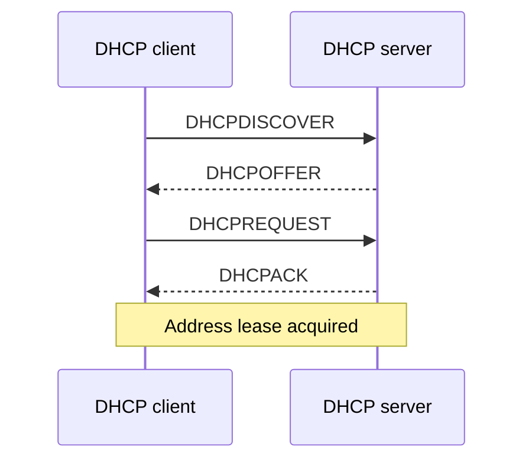

# Nautobot Mermaid diagrams

## Scope and diagram choice

- Create a diagram only for an explicit Mermaid or structural-diagram request about Nautobot. Numeric bar, line, and pie charts remain the `nautobot-charts` skill and `render_chart` tool; this skill produces Markdown, not a tool call or file artifact.
- Choose the view before writing syntax. One diagram should answer one operational question; split a large network into an overview and focused views rather than drawing every record.

| Networking question | Preferred diagram | What to show |
| --- | --- | --- |
| What is cabled to what? | `flowchart TB` or `LR` | Devices, interface endpoints, physical cables and circuit handoffs |
| How is the network logically organized? | `flowchart TB` or `LR` | VLANs, VRFs, prefixes, routing peers, security zones or traffic paths; state which layer is shown |
| What messages happen in order? | `sequenceDiagram` | Protocol exchanges, authentication, automation or Nautobot API interactions |
| What should a technician check next? | `flowchart TD` | Checks, explicit decisions, Yes/No branches and actionable outcomes |
| How does a protocol or operational state change? | `stateDiagram-v2` | States and the events that trigger transitions, only when that state model is requested |
| How do Nautobot objects relate? | `flowchart LR`; `erDiagram` for an explicit data-model request | Documented relationships; use ER cardinality only when verified, not as a count of observed cables |

## Network meaning and evidence

- State whether the view is conceptual, proposed or based on observed Nautobot records. The examples below are conceptual, not claims about the user's network.
- For actual devices, links or topology, first use available Nautobot data. Preserve device names and endpoint pairings; derive unique diagram IDs separately from display names. Do not invent neighbors, interface names, addresses, speeds, VLANs, VRFs, ASNs or statuses to fill gaps.
- Nautobot inventory describes recorded intent/connectivity, not proof of live forwarding, reachability, link health or protocol adjacency. A cable, shared VLAN, common prefix or assigned IP does not prove an operational path or BGP/OSPF session.
- Keep physical cabling, logical relationships and traffic direction distinct. Use an undirected `---` for a physical cable; a cable is not one-way traffic. Use `-->` for an explicitly directed flow or dependency. Use a dotted `-.->` only with an explanation of its meaning, such as a logical dependency; never imply that dotted means down.
- Label links with useful, available facts: endpoint interfaces, recorded speed, circuit ID, VLAN tag or routing protocol. Make endpoint mapping unambiguous, for example `core-01 Eth1 to access-01 Eth49`. Distinguish configured/recorded speed from measured throughput.
- Show redundant links and peers separately when relevant. Distinguish individual LAG members from the aggregate; do not infer active/standby roles, forwarding state, ECMP or failover behavior from redundant cabling alone.
- Use subgraphs for one meaningful grouping level, such as location, rack, network tier, VRF or security zone. A visual group is not a verified connectivity, containment or isolation claim. Avoid deeply nested groups and mixing unrelated grouping schemes.
- Use networking vocabulary and concise device-role labels: WAN, edge, firewall, core, distribution, access, spine, leaf, endpoint. Use the terminology of the actual design; do not force a campus hierarchy onto a leaf-spine fabric or assign unverified roles.
- Report missing endpoints, permission-limited results, filters and truncation outside the diagram. Missing data is not evidence of no connection. If a label cannot pass the renderer restrictions, explain the omission rather than silently changing an actual device name.

## Syntax and readability

1. Start with the diagram declaration and core nodes/participants, then add relationships. Use one statement per line and consistent indentation.
2. Use stable ASCII IDs beginning with a letter, such as `n_core_01`; keep hostnames, IP addresses, interface names and punctuation in quoted display labels: `n_core_01["core-01 (Core)"]`. Declare each node once and reuse its ID.
3. Quote flowchart node, subgraph and edge labels, especially those containing parentheses, colons, slashes or other punctuation. Avoid literal double quotes within labels; rephrase or use a supported entity such as `#quot;`. Do not use backslash escapes, HTML tags or HTML line breaks.
4. Keep Mermaid keywords out of IDs. In flowcharts, lowercase `end` is a block terminator, not a safe bare node ID or label; use `n_end["End"]`. Put spaces around connectors and use prefixed IDs so a leading `o` or `x` is not interpreted as an edge marker.
5. Choose layout intentionally: `TB` for network tiers, `LR` for a WAN path or small peer view; `TD` is equivalent to `TB`. Layout direction does not indicate packet direction. Connect actual nodes, not subgraph IDs, when endpoint identity matters.
6. Use consistent basic shapes: rectangles for devices, rounded nodes for entry/outcomes, diamonds for decisions. Text labels convey the role; do not depend on vendor icons or color to explain the network.
7. Declare sequence participants with safe aliases, such as `participant sw as Access switch`. Use `->>` for a message and `-->>` for a dashed reply; these are sequence notation, not physical-link or transport guarantees. Use `Note`, `alt`/`else`, `opt` or `loop` only when needed to explain the exchange.
8. Close every `subgraph`, sequence `alt`/`opt`/`loop`, state or ER block with its required `end` or brace. Keep branch labels explicit and references consistent. For comments, use standalone `%%` lines sparingly; comments are not visible diagram explanations.
9. Keep labels short and remove unrelated detail before adding more nodes. Put the view's purpose, scope and any nonstandard connector meanings in a short caption outside the fenced block.

## Color for understanding

- When a user asks for colors to help visualize a concept, use Mermaid node styling rather than saying custom colors are unavailable. For flowcharts, use `classDef` plus `class` for related groups, or `style` for individual nodes.
- Limit styling to `fill` (node background), `stroke` (node border), and `color` (label text), using explicit hex colors. Set all three together so text contrasts with its background in both light and dark app themes. Keep the diagram canvas and overall theme app-controlled.
- Use a small, consistent palette to distinguish meaningful roles or relationship types. Explain the grouping in a short caption, and preserve descriptive labels; color must not be the only way to understand the diagram. Do not imply health, reachability, or operational status through color without evidence.
- These node colors do not require custom theme/configuration directives, HTML, or a less restrictive security mode. All renderer restrictions below still apply.

Conceptual example: blue identifies the device, green its interfaces, and purple its optional preferred IPv4 address. The colors distinguish roles, not operational state.

## Networking examples

### Physical topology

Conceptual redundant access uplinks; solid undirected edges represent recorded-style physical cable pairs. This does not assert link state or a loop-prevention design.

### Troubleshooting workflow

Conceptual first checks for an unavailable access port; decision branches describe checks, not observations about a real interface.

### Protocol exchange

Conceptual successful DHCPv4 address acquisition on a local subnet; relays, retransmissions and broadcast/unicast delivery details are omitted.

## Renderer restrictions and final check

- Use a fenced `mermaid` code block and basic text diagrams only. Do not use click directives, custom configuration/theme directives, external images or icons, arbitrary HTML, or scripts. Keep rendering non-interactive and the app's overall theme in control. Simple node colors as described above are supported; avoid other custom styling, layout engines and experimental syntax.
- Do not use backslashes, CSS comments (`/*`), CSS imports (`@import`), CSS resource-function tokens (`url(`, `image(`, `image-set(`, `cross-fade(`, `src(`), or the standalone word `img` anywhere in source, including labels, comments, `classDef`, or `style`. The renderer conservatively falls back to readable source for these patterns, including innocent matching label text; do not rewrite source to evade the check.
- Before returning, check the declaration, unique IDs, quoted labels, endpoint pairings, balanced delimiters/blocks, connector meanings and evidence for every factual label. When using colors, check class assignments and text/background contrast. Remove unsupported syntax rather than assuming generic Mermaid examples render in this app.
- If an authorized local Mermaid validator is available, validate incrementally against the app's bundled version and renderer restrictions. Otherwise perform the syntax check above; never claim parser or visual validation that did not occur. Do not send network inventory to public editors or external export services for validation.
- Return the diagram inline with only the context needed to interpret it. Do not create `.mmd` files, export artifacts or instruct users to install rendering tools unless explicitly requested.
